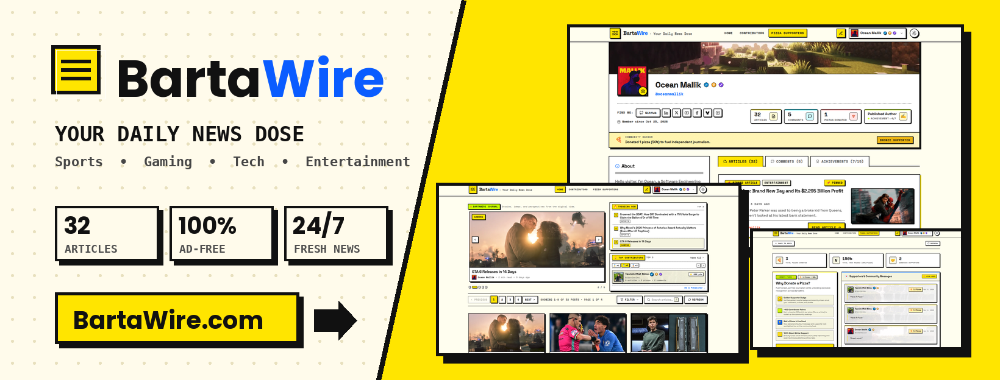

<p align="center">
  
</p>

# 🌊 BartaWire

A fast, modern, and responsive blogging platform built with vanilla web technologies and powered by Supabase.

---

## ✨ Features

- **⚡ Fast & Lightweight**: Zero framework dependencies — built with pure HTML, CSS, and Vanilla JavaScript for instant page loads.
- **📱 Fully Responsive**: Fluid modern layout crafted to look great on mobile, tablet, and desktop screens.
- **🎨 Oceanic Theme**: Built-in Dark and Light mode support with automatic system preference detection.
- **🔍 Instant Search & Topics**: Real-time search across articles with category-based filtering.
- **✍️ Markdown Publishing**: Rich article formatting with GitHub Flavored Markdown and a live split-screen editor.
- **💬 Community & Profiles**: User authentication, profiles, role management, and interactive comments.

---

## 🚀 Getting Started

Since BartaWire is built with pure static files, no complicated build steps or compilation are required!

### 1. Clone the Repository

```bash
git clone https://github.com/oceanmallik/blogWebsite.git
cd blogWebsite
```

### 2. Run Locally

Serve the directory with any local static HTTP server:

**Using Python:**
```bash
python3 -m http.server 8080
```

**Using Node.js:**
```bash
npx serve .
```

Then open `http://localhost:8080` in your web browser.

---

## 🛠️ Built With

- **HTML5 & CSS3** – Clean semantic structure and responsive styling
- **JavaScript (ES6+)** – Lightweight vanilla interactivity and state management
- **Supabase** – Authentication, database, and backend services
- **Marked.js** – Markdown parsing and rendering
